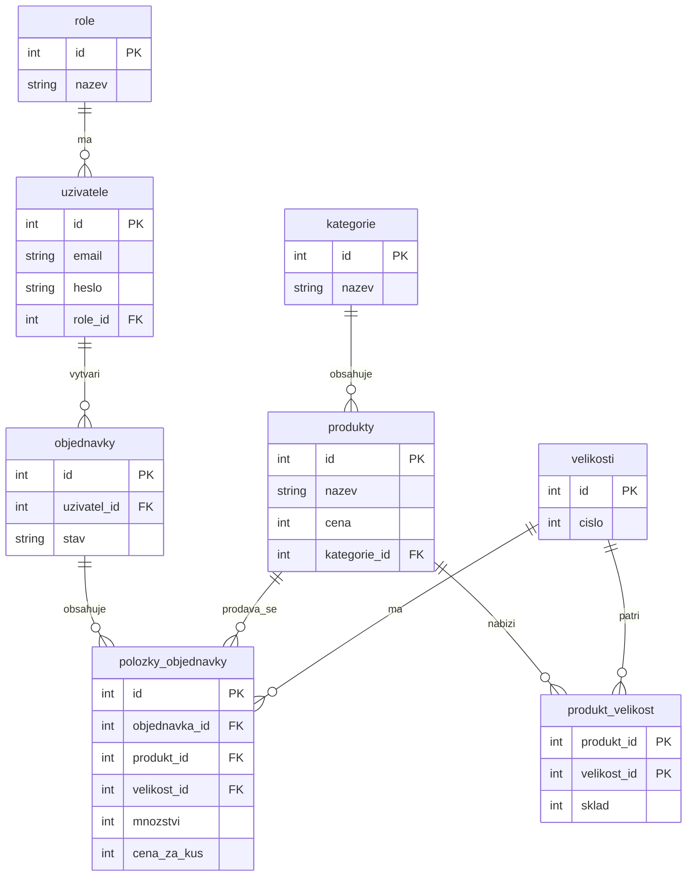

# ER diagram – KopačkyShop

Diagram můžeš otevřít v editoru, který podporuje Mermaid (např. GitHub).

**M:N číslo 1:** produkt ↔ velikost přes `produkt_velikost` (navíc sklad).

**M:N číslo 2:** objednávka ↔ produkt přes `polozky_objednavky` (navíc množství a původní cena).
