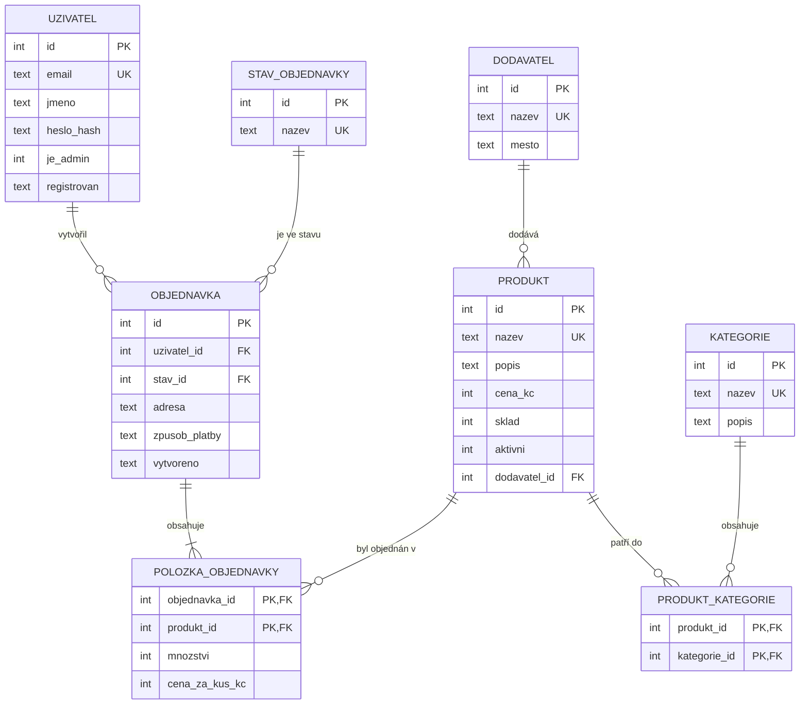

# ER diagram: Zelený kout

Diagram je zapsaný v jazyce [Mermaid](https://mermaid.js.org/), GitHub i GitLab ho
vykreslí přímo při zobrazení tohoto souboru. Stejně dobře ho můžeš nakreslit
v draw.io a uložit jako `er_diagram.png`.

## Vztahy

| Vztah | Typ | Význam | Při mazání |
|-------|-----|--------|-----------|
| dodavatel a produkt | 1:N | dodavatel dodává mnoho produktů | RESTRICT, dodavatele s produkty smazat nejde |
| uzivatel a objednavka | 1:N | zákazník má mnoho objednávek | RESTRICT, zákazníka s objednávkami smazat nejde |
| stav_objednavky a objednavka | 1:N | v jednom stavu je mnoho objednávek | RESTRICT |
| produkt a kategorie | **M:N** | produkt je ve více kategoriích; vazební tabulka `produkt_kategorie` | CASCADE, zařazení zmizí s produktem i s kategorií |
| objednavka a produkt | **M:N** | objednávka má více produktů; vazební tabulka `polozka_objednavky` s atributy `mnozstvi` a `cena_za_kus_kc` | CASCADE ze strany objednávky, RESTRICT ze strany produktu |

Další objekty: pohled `v_objednavka` (objednávka + zákazník + stav + spočítaná cena)
a indexy `idx_objednavka_uzivatel`, `idx_polozka_produkt`.
