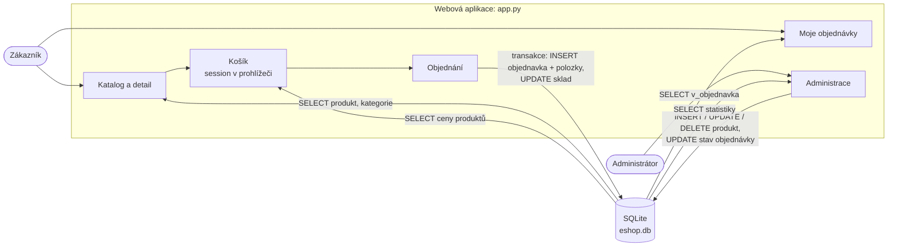

# Návrh projektu: Zelený kout

## Téma
E-shop s pokojovými rostlinami a doplňky. Zákazník si vybere v katalogu, vloží zboží
do košíku a objedná. Administrátor spravuje produkty a vyřizuje objednávky.
Nic se doopravdy neplatí ani neposílá, platba je jen volba „dobírka / převod“.

## Části projektu

| Část | Technologie | K čemu slouží |
|------|-------------|---------------|
| Zákaznická část | Flask + HTML + CSS | katalog, detail produktu, košík, objednávka, historie |
| Administrace | Flask + HTML + CSS | správa produktů, stavy objednávek, přehled tržeb |
| Databáze | SQLite | uživatelé, produkty, kategorie, objednávky a jejich položky |

## Datové toky (co, kde, kam, odkud)

| Data | Kde vznikají | Kam se ukládají | Kdo je čte |
|------|--------------|-----------------|------------|
| účet (e-mail, otisk hesla, role) | registrace | `uzivatel` | přihlášení, objednávky |
| produkty, kategorie, dodavatelé | administrace (a `data.sql`) | `produkt`, `kategorie`, `produkt_kategorie`, `dodavatel` | katalog, košík |
| obsah košíku | tlačítko „Do košíku“ | **session** (cookie), ne databáze | košík, objednání |
| objednávka a položky | dokončení objednávky | `objednavka`, `polozka_objednavky` | historie, administrace, statistiky |
| stav skladu | objednávka (−), zrušení (+), administrace | `produkt.sklad` | katalog, kontrola při objednání |

## Proč je košík v session a ne v databázi
Košík nepřihlášeného návštěvníka nemá komu patřit a většina košíků se nikdy neobjedná.
Do databáze se proto zapisuje až hotová objednávka. Nevýhoda: košík se neuchová mezi zařízeními.

## Plán práce

| Fáze | Termín | Co má být hotové |
|------|--------|------------------|
| 1 | konec října | téma, kostra webu s navigací, návrh všech tabulek, ER diagram, `schema.sql` |
| 2 | konec listopadu | katalog z DB (filtr, hledání, detail), registrace a přihlášení, košík, objednávka v transakci |
| 3 | konec prosince | historie objednávek, administrace, UPDATE/DELETE, testy, dokumentace |
