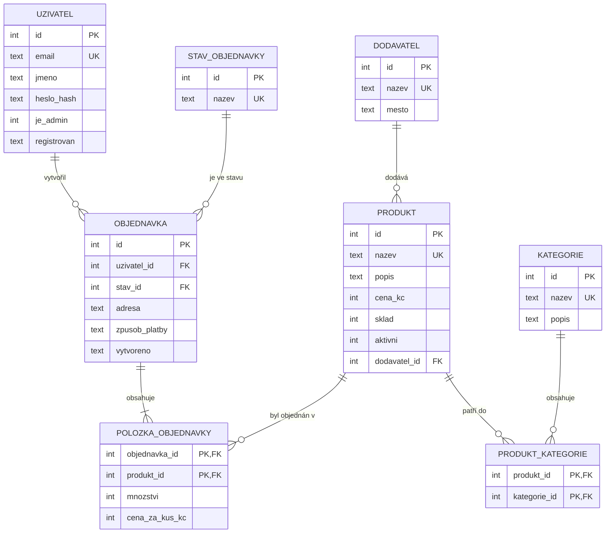

# ER diagram: Zelený kout

Diagram je zapsaný v jazyce [Mermaid](https://mermaid.js.org/), GitHub i GitLab ho
vykreslí přímo při zobrazení tohoto souboru. Stejně dobře ho můžeš nakreslit
v draw.io a uložit jako `er_diagram.png`.

## Vztahy

| Vztah | Typ | Význam | Při mazání |
|-------|-----|--------|-----------|
| dodavatel a produkt | 1:N | dodavatel dodává mnoho produktů | RESTRICT, dodavatele s produkty smazat nejde |
| uzivatel a objednavka | 1:N | zákazník má mnoho objednávek | RESTRICT, zákazníka s objednávkami smazat nejde |
| stav_objednavky a objednavka | 1:N | v jednom stavu je mnoho objednávek | RESTRICT |
| produkt a kategorie | **M:N** | produkt je ve více kategoriích; vazební tabulka `produkt_kategorie` | CASCADE, zařazení zmizí s produktem i s kategorií |
| objednavka a produkt | **M:N** | objednávka má více produktů; vazební tabulka `polozka_objednavky` s atributy `mnozstvi` a `cena_za_kus_kc` | CASCADE ze strany objednávky, RESTRICT ze strany produktu |

Další objekty: pohled `v_objednavka` (objednávka + zákazník + stav + spočítaná cena)
a indexy `idx_objednavka_uzivatel`, `idx_polozka_produkt`.

## Normalizace (BCNF)

Tabulka je v BCNF, když každý sloupec závisí jen na klíči, na celém klíči a na ničem jiném.

| Tabulka | Klíče | Proč je v BCNF |
|---------|-------|----------------|
| `uzivatel` | `id`, `email` | jméno, otisk hesla, role a datum závisí jen na uživateli |
| `dodavatel` | `id`, `nazev` | město je vlastnost dodavatele |
| `kategorie` | `id`, `nazev` | popis je vlastnost kategorie |
| `produkt` | `id`, `nazev` | cena, sklad a popis patří produktu; dodavatel je jen odkaz (FK), jeho název a město se tu neopakují |
| `produkt_kategorie` | (`produkt_id`, `kategorie_id`) | tabulka nemá žádný jiný sloupec než klíč |
| `stav_objednavky` | `id`, `nazev` | čistý číselník |
| `objednavka` | `id` | adresa, platba a datum patří objednávce; jméno zákazníka ani název stavu se neopakují |
| `polozka_objednavky` | (`objednavka_id`, `produkt_id`) | množství i cena závisí na celé dvojici |

Rozhodnutí, která s normalizací souvisí:

- Cena v položce není duplicita. `cena_za_kus_kc` vypadá jako kopie `produkt.cena_kc`, ale
  znamená něco jiného: *za kolik se prodalo tehdy*. Nezávisí na produktu, ale na dvojici
  (objednávka, produkt). Kdyby tam nebyla, zdražení by zpětně změnilo staré objednávky.
- Celková cena objednávky se neukládá. Dá se spočítat z položek, takže by v tabulce
  `objednavka` byla odvozená a mohla by se rozejít se skutečností. Počítá ji pohled `v_objednavka`.
- Adresa je jeden textový sloupec. Kdyby byla rozdělená na ulici, město a PSČ, vznikla by
  závislost města na PSČ (sloupec závislý na něčem, co není klíč) a tabulka by BCNF porušila.
  Správné řešení by byl číselník PSČ, což je pro tento projekt zbytečné.
- Adresa je u objednávky, ne u uživatele. Zákazník si může nechat poslat každou objednávku
  jinam a stará objednávka musí ukazovat, kam se opravdu posílala.
