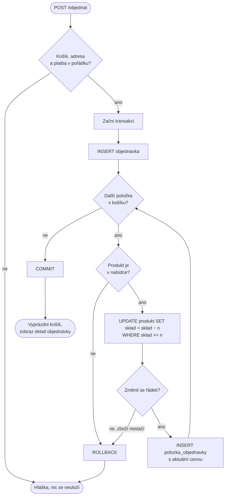
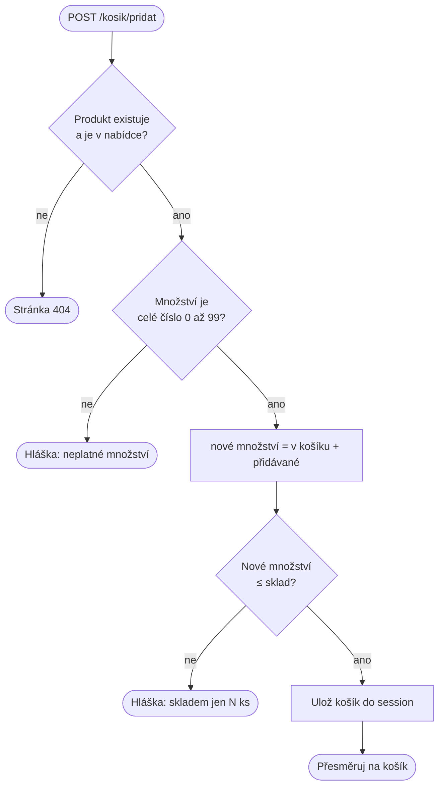
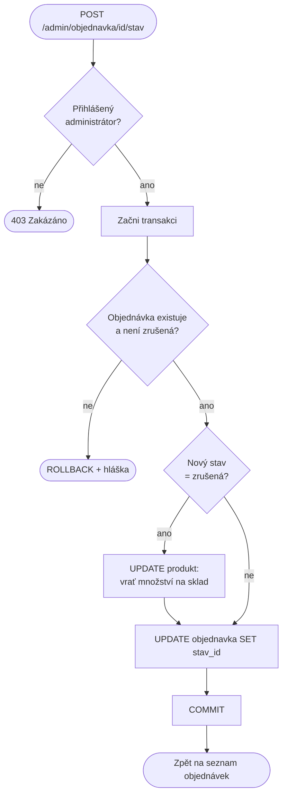

# Vývojové diagramy: Zelený kout

Tři klíčové mechaniky. Diagramy jsou v jazyce Mermaid, GitHub/GitLab je vykreslí.
Zjednodušené verze jsou i na webu na stránce *O projektu*.

## 1. Vytvoření objednávky (`objednavky.vytvor_objednavku`)

## 2. Přidání do košíku (`app.pridat_do_kosiku` + `kosik.pridej`)

## 3. Změna stavu objednávky (`objednavky.zmen_stav`)

