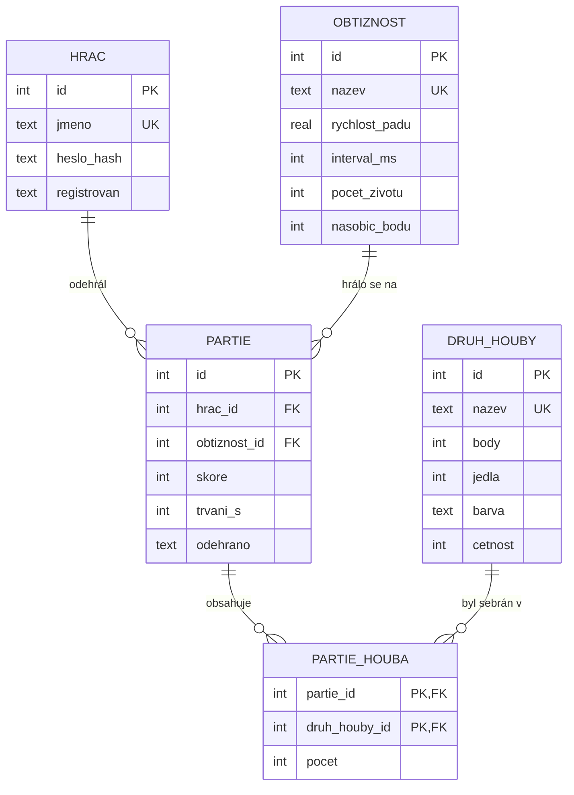

# ER diagram: Houbař

Diagram je zapsaný v jazyce [Mermaid](https://mermaid.js.org/), GitHub i GitLab ho
vykreslí přímo při zobrazení tohoto souboru. Stejně dobře ho můžeš nakreslit
v draw.io a uložit jako `er_diagram.png`.

## Vztahy

| Vztah | Typ | Význam |
|-------|-----|--------|
| hrac a partie | 1:N | jeden hráč odehraje mnoho partií, partie patří právě jednomu hráči |
| obtiznost a partie | 1:N | na jednu obtížnost se hraje mnoho partií |
| partie a druh_houby | **M:N** | v partii se sebere víc druhů hub, druh se objeví v mnoha partiích; řeší vazební tabulka `partie_houba` s atributem `pocet` |
