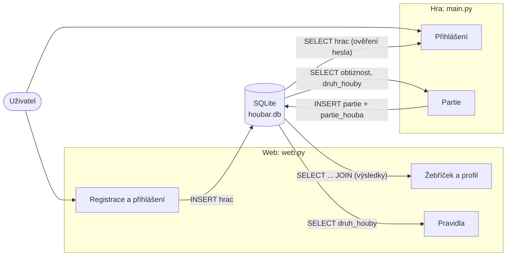

# Návrh projektu: Houbař

## Téma
Postřehová hra: z horní hrany okna padají houby a hráč je chytá do košíku.
Jedlé houby přidávají body, jedovaté ubírají životy. Partie trvá 60 sekund.

## Části projektu

| Část | Technologie | K čemu slouží |
|------|-------------|---------------|
| Hra | Python + Pygame | menu, přihlášení hráče, samotná partie |
| Web | Flask + HTML + CSS | informace o hře, registrace, žebříček, profil |
| Databáze | SQLite | hráči, obtížnosti, druhy hub, odehrané partie |

## Datové toky (co, kde, kam, odkud)

| Data | Kde vznikají | Kam se ukládají | Kdo je čte |
|------|--------------|-----------------|------------|
| účet hráče (jméno, otisk hesla) | registrace na webu | tabulka `hrac` | přihlášení ve hře i na webu |
| obtížnosti a druhy hub | `databaze/data.sql` | `obtiznost`, `druh_houby` | hra (co má padat, jak rychle), web (pravidla) |
| výsledek partie | hra po skončení partie | `partie` | web (žebříček, profil), hra (nejlepší hráči) |
| sebrané houby | hra po skončení partie | `partie_houba` | web (statistika v profilu) |

## Proč je SQL jen v jednom souboru
Hra i web volají funkce z `db.py`. Kdyby si každá část psala dotazy sama,
musel bych každou změnu tabulky opravovat na dvou místech.

## Plán práce

| Fáze | Termín | Co má být hotové |
|------|--------|------------------|
| 1 | konec října | téma, menu hry, kostra webu, návrh DB, ER diagram, `schema.sql` |
| 2 | konec listopadu | pohyb a logika hry, ukládání do DB, registrace a přihlášení, žebříček |
| 3 | konec prosince | obtížnosti, pauza, profil, UPDATE/DELETE, testy, dokumentace |
