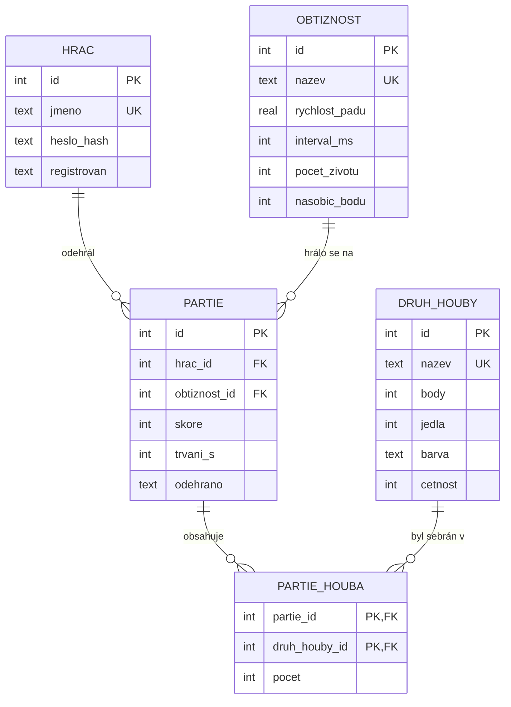

# ER diagram: Houbař

Diagram je zapsaný v jazyce [Mermaid](https://mermaid.js.org/), GitHub i GitLab ho
vykreslí přímo při zobrazení tohoto souboru. Stejně dobře ho můžeš nakreslit
v draw.io a uložit jako `er_diagram.png`.

## Vztahy

| Vztah | Typ | Význam |
|-------|-----|--------|
| hrac a partie | 1:N | jeden hráč odehraje mnoho partií, partie patří právě jednomu hráči |
| obtiznost a partie | 1:N | na jednu obtížnost se hraje mnoho partií |
| partie a druh_houby | **M:N** | v partii se sebere víc druhů hub, druh se objeví v mnoha partiích; řeší vazební tabulka `partie_houba` s atributem `pocet` |

## Normalizace (BCNF)

Tabulka je v BCNF, když každý sloupec závisí jen na klíči, na celém klíči a na ničem jiném.

| Tabulka | Klíče | Proč je v BCNF |
|---------|-------|----------------|
| `hrac` | `id`, `jmeno` | heslo i datum registrace závisí jen na hráči |
| `obtiznost` | `id`, `nazev` | rychlost, interval, životy a násobič jsou vlastnosti obtížnosti |
| `druh_houby` | `id`, `nazev` | body, jedlost, barva a četnost jsou vlastnosti druhu |
| `partie` | `id` | skóre, délka a datum patří konkrétní partii; jméno hráče ani název obtížnosti se tu **neopakují**, jsou jen odkazy (FK) |
| `partie_houba` | (`partie_id`, `druh_houby_id`) | `pocet` závisí na celé dvojici, ne jen na partii nebo jen na druhu |

Co by normalizaci **porušilo** (a proč to v návrhu není):
- sloupec `jmeno_hrace` v tabulce `partie`: jméno by se opakovalo a při přejmenování by se muselo měnit na mnoha místech,
- sloupce `pocet_hribu`, `pocet_lisek` atd. v tabulce `partie`: při přidání nového druhu houby by se musela měnit struktura tabulky.
