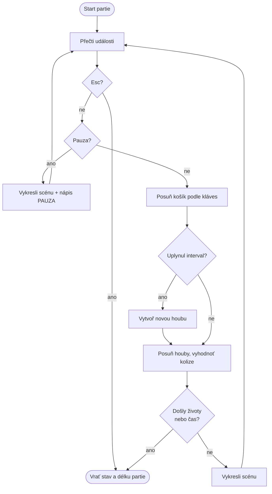
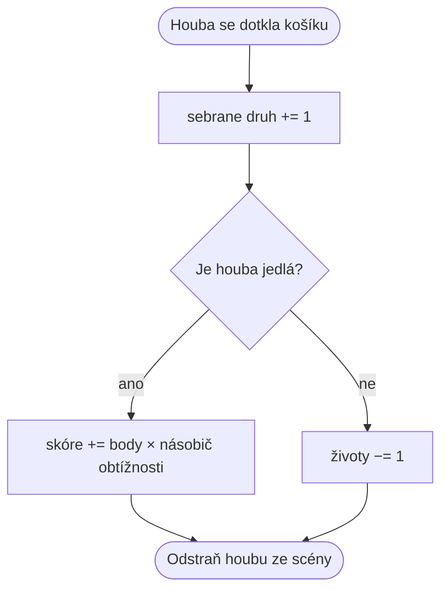
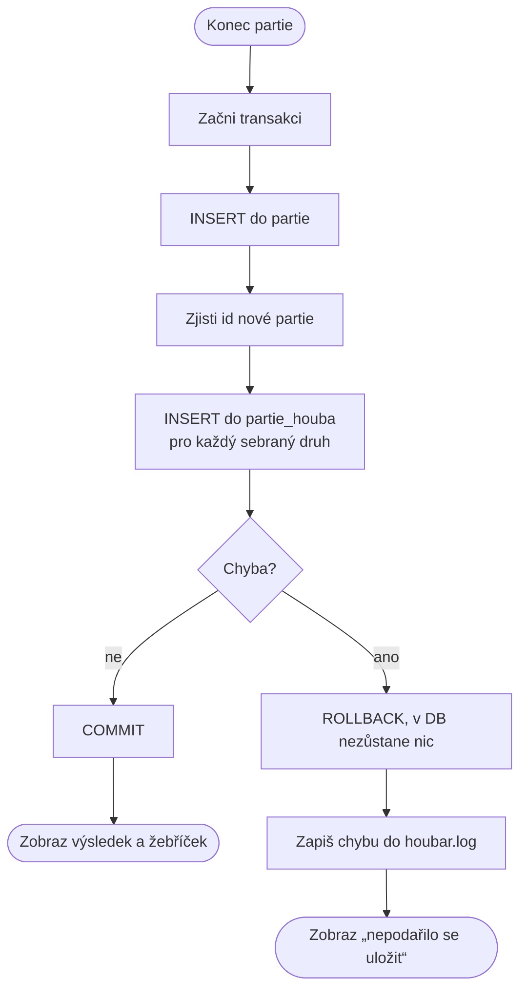

# Vývojové diagramy: Houbař

Tři klíčové mechaniky. Diagramy jsou v jazyce Mermaid, GitHub/GitLab je vykreslí.
Zjednodušené verze jsou i na webu na stránce *O projektu*.

## 1. Herní smyčka (`hra/partie.py`)

## 2. Chycení houby (`StavHry.seber` v `hra/logika.py`)

## 3. Uložení partie (`db.uloz_partii`)

