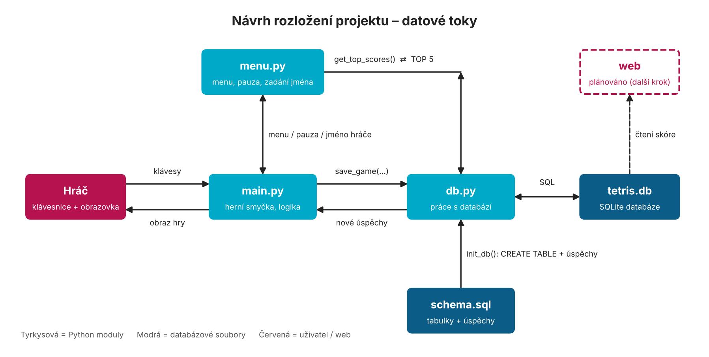
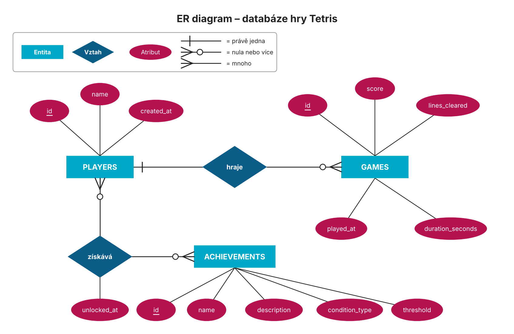

# Tetris

Klasická hra Tetris napsaná v Pythonu (Pygame) s databází výsledků v SQLite.

## 1. Výběr tématu

Zvolil jsem hru **Tetris**. Pravidla jsou jednoduchá a známá, ale hra zahrnuje spoustu zajímavé logiky (kolize, otáčení kostek, mazání řádků, skóre) a výsledky her se přirozeně ukládají do databáze.

| Část | Technologie |
|------|-------------|
| Hra | Python 3 + Pygame |
| Databáze | SQLite (soubor `tetris.db`, SQL ve `schema.sql`) |

## 2. Funkční menu

**Hlavní menu**
- `1` nebo `Enter` – začít hru
- `ESC` – ukončit
- zobrazuje **TOP 5** nejlepších výsledků z databáze

**Ve hře**
- `←` `→` – pohyb kostky, `↓` – rychlejší pád, `↑` – otočení
- `P` – pauza (v pauze `P` pokračuje, `ESC` ukončí)

**Konec hry**
- obrazovka *GAME OVER* se zadáním jména hráče (max 10 znaků, `Enter` uloží, prázdné jméno se uloží jako „Anonym“)
- pokud hráč splnil nějakou podmínku, ukáže se obrazovka **NOVÝ ÚSPĚCH!**

## 3. Návrh rozložení projektu (datové toky)



| Soubor | Co dělá | Odkud bere data | Kam je posílá |
|--------|---------|-----------------|---------------|
| `main.py` | herní smyčka, logika, vykreslení | klávesy od hráče, menu | obraz hry hráči, `db.save_game()` |
| `menu.py` | hlavní menu, pauza, zadání jména, úspěchy | `main.py`, `db.get_top_scores()` | volba / jméno zpět do `main.py` |
| `db.py` | veškerá práce s databází | `main.py`, `menu.py`, `schema.sql` | SQL dotazy do `tetris.db` |
| `schema.sql` | struktura databáze a výchozí úspěchy | – | spouští ho `db.init_db()` při startu hry |
| `tetris.db` | uložená data (vytvoří se sama) | SQL z `db.py` | výsledky zpět do `db.py` |
| `queries.sql` | ukázkové dotazy pro statistiky | `tetris.db` | – |

Průběh jedné hry:
1. Při startu `main.py` zavolá `db.init_db()`, ten spustí `schema.sql` (vytvoří tabulky, když neexistují).
2. `menu.py` si z `db.py` vezme TOP 5 a zobrazí je v hlavním menu.
3. Hráč hraje, `main.py` počítá skóre, smazané řádky a čas.
4. Po konci hry se zadá jméno a `main.py` zavolá `db.save_game()`, který uloží hráče, hru a případně odemkne úspěchy.

Plánovaný další krok: webová stránka, která bude číst skóre ze stejné `tetris.db`.

## 4. Návrh databáze

Celá databáze je v souboru [`schema.sql`](schema.sql).

**`players`** – hráči
| Sloupec | Typ | Poznámka |
|---------|-----|----------|
| id | INTEGER | primární klíč |
| name | TEXT | unikátní jméno hráče |
| created_at | TEXT | datum vytvoření |

**`games`** – odehrané hry
| Sloupec | Typ | Poznámka |
|---------|-----|----------|
| id | INTEGER | primární klíč |
| player_id | INTEGER | cizí klíč → `players.id` |
| score | INTEGER | skóre (≥ 0) |
| lines_cleared | INTEGER | smazané řádky |
| duration_seconds | INTEGER | délka hry |
| played_at | TEXT | datum a čas hry |

**`achievements`** – seznam úspěchů
| Sloupec | Typ | Poznámka |
|---------|-----|----------|
| id | INTEGER | primární klíč |
| name | TEXT | unikátní název |
| description | TEXT | popis |
| condition_type | TEXT | `games`, `score` nebo `lines` |
| threshold | INTEGER | hranice pro splnění (> 0) |

**`player_achievements`** – získané úspěchy (vazba M:N)
| Sloupec | Typ | Poznámka |
|---------|-----|----------|
| player_id | INTEGER | cizí klíč → `players.id` (součást PK) |
| achievement_id | INTEGER | cizí klíč → `achievements.id` (součást PK) |
| unlocked_at | TEXT | kdy byl úspěch získán |

**Vztahy:** hráč má více her (1:N); hráč může získat více úspěchů a úspěch může mít více hráčů (M:N přes `player_achievements`).
Pro rychlé řazení jsou vytvořeny indexy `idx_games_score` a `idx_games_player`.

## 5. ER diagram



## 6. Spuštění

```bash
pip install pygame
python main.py
```

Databáze se vytvoří sama (spustí se `schema.sql`). Ruční vytvoření databáze:

```bash
sqlite3 tetris.db < schema.sql
```

nebo bez programu `sqlite3`:

```bash
python -c "import sqlite3; sqlite3.connect('tetris.db').executescript(open('schema.sql', encoding='utf-8').read())"
```

Do databáze se dá podívat v programu *DB Browser for SQLite* (záložka *Execute SQL* spustí třeba `queries.sql`).
